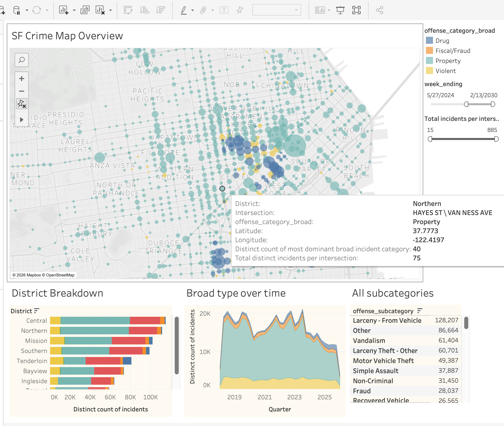
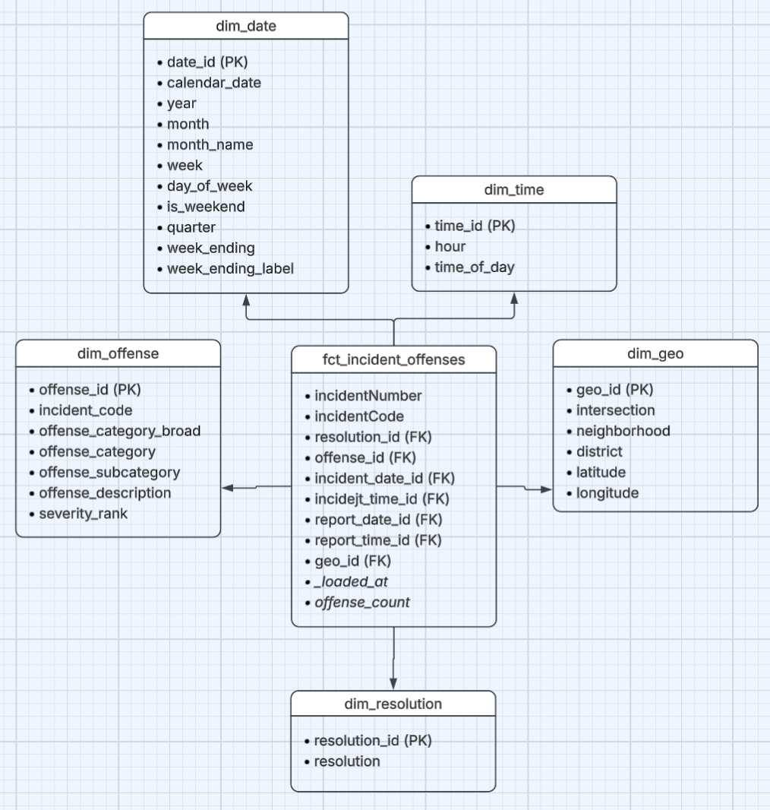

# SF Crime Data Warehouse

An end-to-end analytics engineering project built with **dbt + DuckDB**, transforming raw San Francisco crime data into an analytics-ready dimensional model for interactive analysis and visualization in Tableau:



*Users can filter by time range, categories, and total incidents to explore how crime patterns vary geographically and evolve over time.*

---

## Project Overview

Transforms raw SFPD incident records (https://data.sfgov.org/Public-Safety/Police-Department-Incident-Reports-2018-to-Present/wg3w-h783) into a clean warehouse that answers:

- How has crime changed over time?
- Which neighborhoods/districts see the most incidents?
- What crime categories are most common?
- What percentage of offenses are resolved?



**Fact grain:** one row = one offense (`Incident Number + Incident Code`), reflecting its latest authoritative state.

Incident Number = the overall case.
Incident ID = a write-up/report filed for that case, containing a batch of offense codes.
Incident Code = one offense within that batch.


---

## Architecture

```
Raw Crime CSV → Landing → Staging (dbt) → Intermediate (dedup) → Marts → BI
```

| Tool | Purpose |
|---|---|
| DuckDB | Local analytical database |
| dbt | Transformations, testing, docs |
| Python/pandas | Source profiling |

---


## Deduplication Logic

Each offense (`Incident Number + Incident Code`) may have multiple report updates over its lifecycle. The intermediate layer collapses these to one authoritative row:

1. Prefer a finalized resolution (`Cite or Arrest Adult`, `Exceptional Adult`, `Unfounded`) over `Open or Active`.
2. Among candidates, take the latest `Report Datetime`.
3. On a true timestamp tie (common when two separate reports, e.g. an Initial and a Supplement, land at the same rounded timestamp), break with `Incident ID` descending, since it's the system-assigned, monotonically increasing report identifier.

```sql
row_number() over (
    partition by incidentNumber, incidentCode
    order by
        case when resolution in ('Cite or Arrest Adult','Exceptional Adult','Unfounded')
             then 1 else 0 end desc,
        reportDatetime desc,
        incidentId desc
) as rn
```

**Impact:**

| Statistic | Value |
|---|---:|
| Raw report rows | 937,866 |
| Canonical offense rows | 883,613 |
| Rows collapsed | 54,253 (5.78%) |
| Avg. reports per incident | 1.40 |
| Avg. reports per incident-offense | 1.06 |

The low collapse rate confirms most removed rows are report-lifecycle noise (supplements/updates), not distinct analytical events; the grain choice loses minimal information while eliminating duplication.

---

## dbt Model Structure

```
models/
├── staging/
│   └── stg_crime_incidents.sql        (native grain: incidentId + incidentCode)
├── intermediate/
│   └── int_latest_crime_incidents.sql (dedup → incidentNumber + incidentCode)
└── marts/
    ├── facts/
    │   └── fct_incident_offenses.sql
    └── dimensions/
        ├── dim_date.sql
        ├── dim_geo.sql
        └── dim_offense_category.sql
        └── dim_time.sql
        └── dim_resolution.sql
```

**Staging** preserves source fidelity (clean types, standardize category strings, filter invalid/placeholder incident numbers like `000000000`). **Intermediate** applies the dedup business rule above. **Marts** expose analyst-friendly naming — e.g. `offenseCategory` instead of the source's `Incident Category`, since the fact table's grain is the offense, not the whole case.

---

## Fact & Dimensions

**`fct_incident_offenses`** — grain: 1 row = 1 Incident Number + 1 Incident Code. Contains offense/geo/category keys, resolution, lat/long as descriptive attributes (low-cardinality, no reuse case — kept in-fact rather than dimensionalized).

| Col | Info |
|---|---|
| `incidentNumber` | Police case / incident identifier (degenerate dimension) |
| `incidentCode` | Specific offense identifier within an incident (degenerate dimension) |
| `resolution_id` | FK to dim_resolution |
| `offense_id` | FK to dim_category |
| `incident_date_id` | FK to dim_date |
| `incident_time_id` | FK to dim_time |
| `report_date_id` | FK to dim_date |
| `report_time_id` | FK to dim_time |
| `geo_id` | FK to dim_geo |
| `_loaded_at` | dbt datetime created in staging |
| `offense_count` | measure |

As of run on Jul 8 2026 (using 3+ month old CSV), fact has 883,613 rows spanning incident dates 2018-01-01 to 2026-2-04.

| Dimension | Supports |
|---|---|
| `dim_date` | Trends, seasonality, day-of-week |
| `dim_time` | Hours, time-of-day |
| `dim_geo` | Neighborhood, district, intersection, latitude, longitude |
| `dim_offense` | Standardized category, broad grouping (Violent/Property/etc.), severity rank, subcategory, description |
| `dim_resolution` | Final disposition/outcome of the incident (e.g., arrest made, citation issued, no action, unresolved) |

Incident-level metrics (e.g. "how many police cases occurred?") remain available via `COUNT(DISTINCT incident_number)` against the fact table.


---
## Incremental Fact Loading

`fct_incident_offenses` is implemented as a dbt incremental model using a merge strategy.

The fact table uses incident_number and incident_code as its natural unique key:

```sql
{{ config(
    materialized='incremental',
    incremental_strategy='merge',
    unique_key=['incidentNumber', 'incidentCode']
) }}


## Data Quality Tests

```yaml
- name: stg_crime_incidents
  tests:
    - dbt_utils.unique_combination_of_columns:
        arguments:
          combination_of_columns: [incidentId, incidentCode]

- name: int_latest_crime_incidents
  tests:
    - dbt_utils.unique_combination_of_columns:
        arguments:
          combination_of_columns: [incidentNumber, incidentCode]

- name: fct_incident_offenses
    tests:
      - dbt_utils.unique_combination_of_columns:
          arguments:
            combination_of_columns: [incidentNumber, incidentCode]
```

Plus standard `not_null`/`unique` checks on dimension surrogate keys and `accepted_values` on `resolution`.

---

## Running Locally
Download the sf crime incidents csv (https://data.sfgov.org/Public-Safety/Police-Department-Incident-Reports-2018-to-Present/wg3w-h783/about_data), name it 'sf_crime.csv' and place into the root of this directory. 

```bash
pip install -r requirements.txt
dbt deps # for installing db utils
dbt debug
dbt build          # run all models + tests
```

Run a specific layer:
```bash
dbt build --select staging
dbt build --select intermediate
dbt build --select marts.facts
dbt build --select marts.dimensions

Test:
dbt test --select stg_crime_incidents

Use duckdb_jdbc-1.3.0.0.jar to connect in tablaeu
```
---

## Future Improvements

- Airflow orchestration
- Cloud warehouse deployment
- Snapshots to track offense resolution history over time

---

